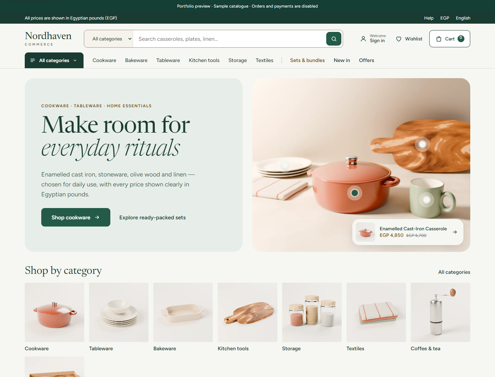
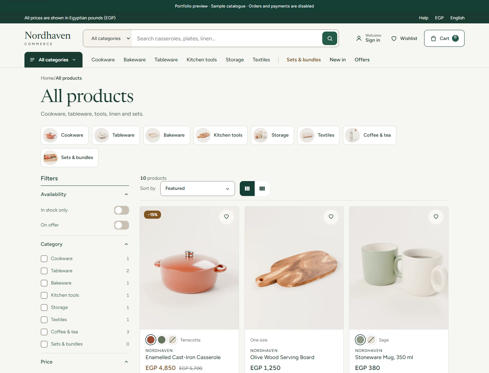
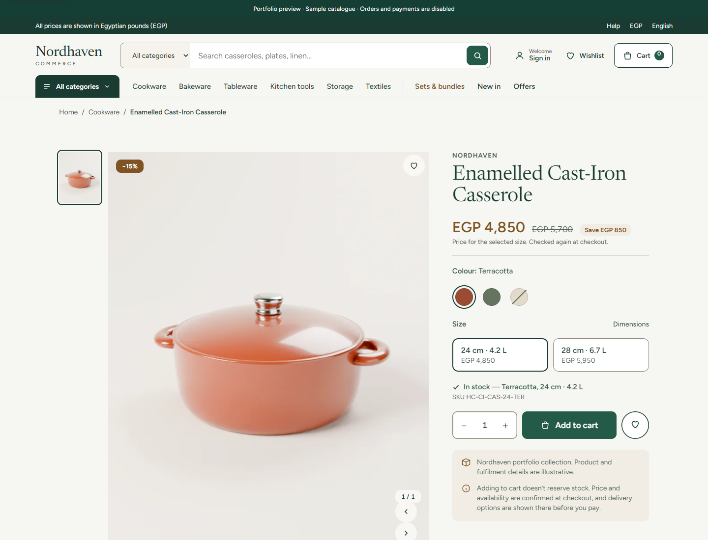

# Nordhaven Commerce

An editorial commerce storefront with a NestJS backend, transactional inventory and a clearly separated, read-only portfolio preview.

[](https://github.com/Zyadashraf5/nordhaven-commerce/actions/workflows/ci.yml)



## What this project demonstrates

- **Full-stack boundaries:** Next.js App Router and React on the storefront; NestJS application services, module contracts and Prisma/PostgreSQL persistence on the server.
- **Order integrity:** server-recomputed prices, integer minor-unit amounts, transaction-scoped inventory reservations and idempotent order creation.
- **Authentication:** a protected-by-default API guard; storefront sessions use an httpOnly cookie and same-origin server handlers.
- **Usable catalogue:** category filters, search, product variants, responsive layouts, keyboard interactions and reduced-motion support.
- **Engineering checks:** unit tests, PostgreSQL integration tests, API end-to-end tests, frontend tests, dependency audit and CI.

This is a rebranded portfolio edition of my existing commerce codebase. Nordhaven is a fictional showcase identity, not a claim of a new deployed client business. The application code and database migrations are retained; the public history starts clean and contains no original runtime environment files.

## Screens

| Catalogue                                          | Product details                                          |
| -------------------------------------------------- | -------------------------------------------------------- |
|  |  |

[Mobile storefront](docs/screenshots/storefront-mobile.png) · [Mobile catalogue](docs/screenshots/catalog-mobile.png)

These are actual browser captures of the local application, not design mockups. Product photography and fonts are included in the repository; font license notices remain in `front/public/fonts`.

## Run the offline portfolio preview

Use Node **22.23.3** and pnpm **12.13.0**.

```powershell
corepack enable
corepack prepare pnpm@12.13.0 --activate
pnpm install --frozen-lockfile
$env:NORDHAVEN_DEMO = '1'
pnpm front:dev
```

Open http://localhost:3001. On macOS/Linux, use `NORDHAVEN_DEMO=1 pnpm front:dev`.

The explicit preview flag enables a sample catalogue adapter. It is **never** activated because a real API failed. The banner labels the data as illustrative. Accounts, wishlist persistence, cart mutations, orders and payments are unavailable in this preview; backend proxy calls return a clear read-only response. No customer database or payment provider is required.

## Run the full local backend

1. Copy `.env.example` to `.env` and configure a disposable local PostgreSQL database and your own development encryption key. Never use production credentials.
2. Run `pnpm db:up`, then `pnpm db:wait` if using the included PostgreSQL container.
3. Run `pnpm prisma:generate` and `pnpm prisma:migrate:deploy` against that disposable database.
4. Run `pnpm dev`. In another terminal, **remove** `NORDHAVEN_DEMO` and run `pnpm front:dev` with the local API configuration.

The full backend includes more than the offline preview. Local test payment behavior is not evidence of live payment certification. See the architecture and test documentation before configuring external services.

## Read the code

| Concern                               | Entry point                                               |
| ------------------------------------- | --------------------------------------------------------- |
| Order transaction and replay handling | `apps/api/src/modules/order/application/order.service.ts` |
| Cart ownership and prices             | `apps/api/src/modules/cart/application/cart.service.ts`   |
| API authentication boundary           | `apps/api/src/platform/security/session-auth.guard.ts`    |
| Catalogue source seam                 | `front/src/lib/live-catalog.ts`                           |
| Explicit preview fixtures             | `front/src/lib/portfolio-catalog.ts`                      |
| Order and stock integration scenarios | `test/integration/order-preorder.integration.spec.ts`     |

## Validation

Local checks on 12 November 2026: **416 backend unit tests passed**; **223 frontend tests passed**, with 21 opt-in integration tests skipped. Frontend type checking, lint and production compilation passed. Production dependency audit reported zero known advisories after patching Zod, body-parser and multer.

The new edition's PostgreSQL integration and API end-to-end suites are run by GitHub Actions; their current result is shown by the badge, not implied by the local unit count. Browser checks exercised the preview home, catalogue and product pages at desktop/mobile sizes, with no page errors or horizontal mobile overflow.

```powershell
pnpm prisma:generate
pnpm typecheck
pnpm test:unit
pnpm front:test
pnpm front:lint
pnpm front:build
pnpm audit --prod
```

Set `DATABASE_URL` to a disposable local database before Prisma commands. The generated client is not committed. CI includes PostgreSQL-backed suites separately from the browser-only preview.

## Boundaries

This repository is a reviewable portfolio edition, not a promise of production readiness. The preview does not process real money or orders. Screenshots contain sample data. Secrets are configured locally, and `.gitleaks.toml` contains only narrow exceptions for reviewed synthetic test values.
